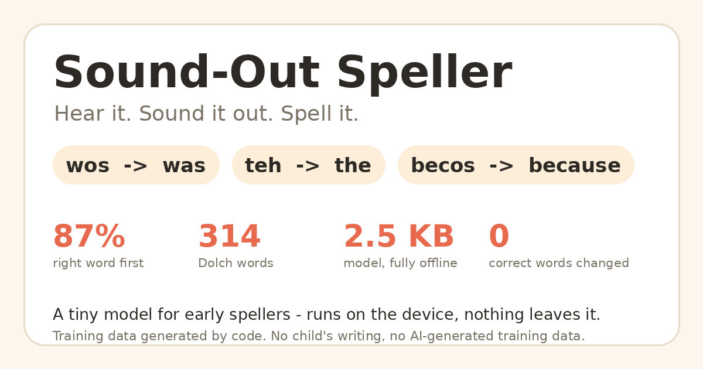

# Sound-Out Speller — tiny ML for early spellers

A kid hears a word, spells it the way it sounds — **wos**, **teh**, **becos** — and this
tiny model figures out which word they meant, names the spelling pattern they missed,
and never "corrects" a word that was already spelled right.

It runs **entirely on the device** (browser, tablet, Chromebook). No account, no uploads,
no internet after the page loads — built for homeschool families and classrooms.

**Try it:** open [`demo/index.html`](demo/index.html) in any browser. Practice mode speaks
a word aloud; Check mode takes any sound-it-out spelling. Parents can paste in this week's
spelling list and it joins the model's vocabulary on the spot.

## Default model — C2-AFFR (keeper)

**`model_c2.npz` — 6,767 bytes — is the current default model.** It is the C1b
model with exactly one change: the **affrication** error family
(kids writing *tree* as **chree**, *dress* as **jress** — tr→chr, dr→jr)
is no longer held out of training. It enters the training generator's
family mix at a pre-registered 50% rate; vocabulary (frozen 1,000 words),
recipe, 47 features, and family weights are otherwise identical to C1b.
Pre-registered before training (`c2-affr-preregistration.md`).

On the fresh generated exam (seed 103101; 1,754 held-out attempts,
pair-disjoint from the C2 training pool; all rankers scored on the
identical exam in one sitting):

| Metric | C2-AFFR (default) | C1b (same exam) | Plain edit distance (B0) |
|---|---|---|---|
| Right word ranked #1 | **95.38%** | 94.47% | 76.23% |
| Right word in top 3 | **99.89%** | 99.09% | 91.09% |
| Affrication family (n=18) | **88.9%** | 11.1% | 50.0% |
| Dolch-314 slice, right word #1 | **91.67%** | — | — |
| th→f/v family (n=26) | **96.2%** | 96.2% | 57.7% |
| Cluster-reduction family (n=86) | **80.2%** | 84.9% | 41.9% |
| Correct spellings changed | **0%** (1,000/1,000 self-rank #1, S2 on and off) | 0% | 0% |
| Model size | **6,767 bytes** | 6,767 bytes | — |

Affrication was the previous model's weakest family by far (13.6% on
C1b's own exam); ten training rows — half of the 28 words that can even
produce the pattern — closed the gap. On a second, eval-only exam —
real misspellings from the Birkbeck amalgamation filtered to the 1,000
target words (5,499 pairs; eval-only under OTA terms, never shipped) —
C2 ranks the right word #1 **42.64%** of the time vs 39.59% for plain
edit distance.

> **Disclosure — generated-exam only:** The headline numbers are scored on
> code-generated exams; this model has never been scored on real children's
> misspellings (the CHES real exam was retired by owner decision on
> 2026-11-19 after the source archive proved unobtainable — see
> PROVENANCE). The Birkbeck exam above is eval-only adult/student/child
> mixed corpus data, not CHES.

> **Vocabulary attribution:** Vocabulary includes words from the New General
> Service List / New Dolch List by Browne & Culligan, licensed CC BY-SA 4.0.
> Share-alike applies to the vocabulary list as shipped; no other project
> data is re-licensed by this.

**What the views are:** C2 keeps the v3/C1b feature set — the original 16
spelling/phonetic pair features plus four extra "views" of the same attempt
(47 features total): an onset–rime view, a th-aware sound form (the sound
*th* is no longer collapsed to *t*), letter-name features, and a
developmental family-posterior view — "which known kid-error family
(silent-e drop, cluster reduction, th→f, affrication, …) best explains
this attempt as a misspelling of this candidate?" A small deterministic
letter-name lookup (S2: r→are, u→you, c→see…) rides along at ~0 bytes.
The full record is in `PROVENANCE.md` and `metrics_c2.json`.

## How it works

- **Bounded vocabulary:** 1,000 high-value words — the Dolch list (220
  service words + nouns, compiled 1936/1948, public domain) extended with
  the modernised New Dolch List and NGSL frequency headwords (CC BY-SA 4.0,
  see attribution above). That bound is what makes a ~7 KB model accurate
  enough to be useful.
- **Model:** a logistic-regression *pair ranker*. For a typed attempt it
  scores every vocabulary word on spelling/phonetic features and ranks
  them. Trained on Colab CPU.
- **Training data is code, not kids:** practice misspellings are generated
  by deterministic phonics-error rules applied to the word list. No child's
  writing, no personal data, and no frontier-AI output anywhere in
  training — see `PROVENANCE.md`.
- **Exact-match rule:** if the attempt already *is* a vocabulary word, it
  is trusted, so the product never changes a correct word.

## Previous models, kept for comparison

### C1b — previous default (1,000-word vocab, affrication held out)

`model_c1b.npz` (6,767 bytes) with `metrics_c1b.json`. On its own fresh
generated exam (2,403 attempts): 94.34% top-1, 99.21% top-3, Dolch-314
slice 89.41%, correct spellings changed 0% — but affrication only 13.6%
(n=22), the weakness C2-AFFR was built to attack.

### v3 — previous default (Dolch-314)

`model_v3.npz` (3,482 bytes) with `metrics_v3.json`. On its own fresh
generated exam (203 attempts): 93.10% top-1, 99.51% top-3, th→f/v family
95.2%, correct spellings changed 0%. On the C1b expanded exam v3 scores
3.37% — it ranks over the 314-word vocabulary only, so the 686 new target
words are unreachable for it by construction; that structural gap is the
point of C1b, not a like-for-like quality comparison.

### v1 / v2

v1 (former keeper) and v2 (never default, superseded) remain in the repo
with their metrics for comparison. See `PROVENANCE.md` for the full
history, including the Phase 1 view-probe development record.
